<div align="center">


# StudyNight

**Your notes, turned into a game.**

Upload your slides, notes, a PDF or a photo of your notebook — about thirty seconds later you are playing a quiz built
from *your* material. Every question shows where in your notes it came from, and StudyNight brings back what you find
tricky until the exam.

[](https://github.com/UmitKayaardi/studynight/actions/workflows/ci.yml)


### [▶ Open the live app](https://studynight-sable.vercel.app) · Try a sample deck — no upload needed

</div>

<!-- DEMO GIF: record a short screen capture and save it as docs/demo.gif, then replace this comment with:
<p align="center"></p> -->

## Screenshots

| | Home | Topic map | Question | Source of a question | Explain in your own words |
|---|---|---|---|---|---|
| **Light** | 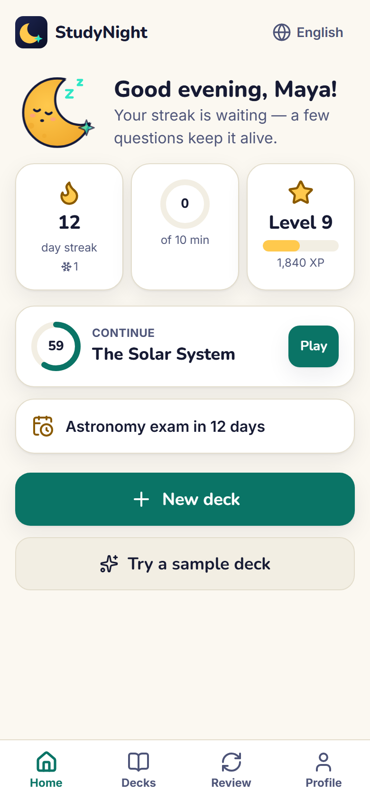 | 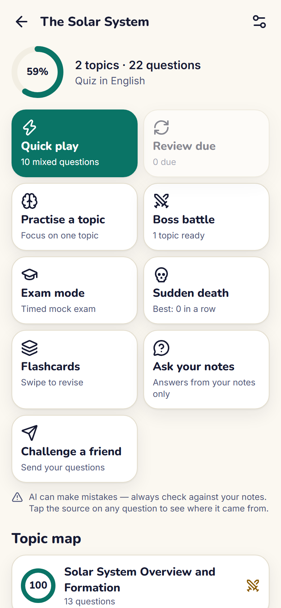 | 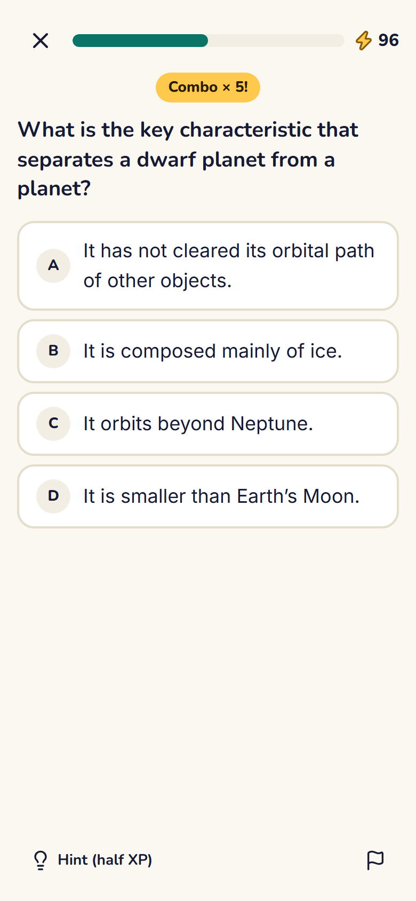 | 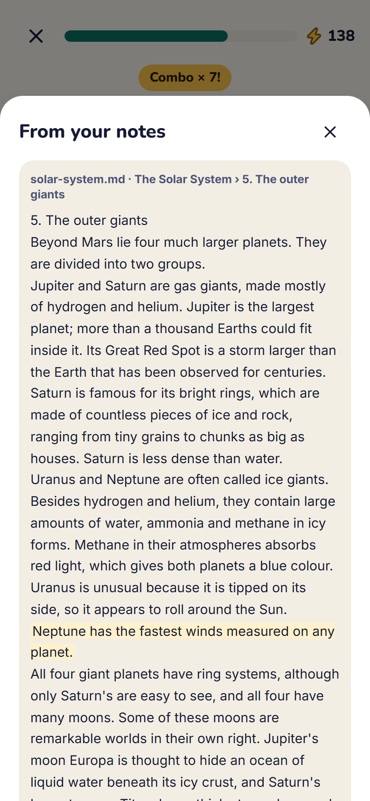 | 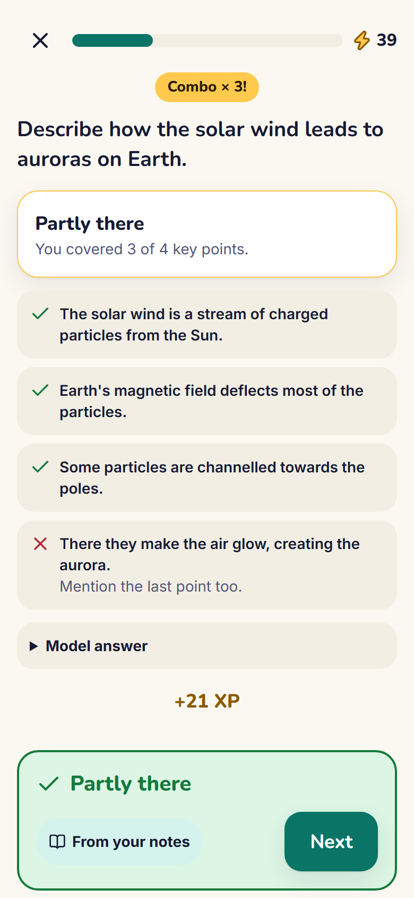 |
| **Dark** | 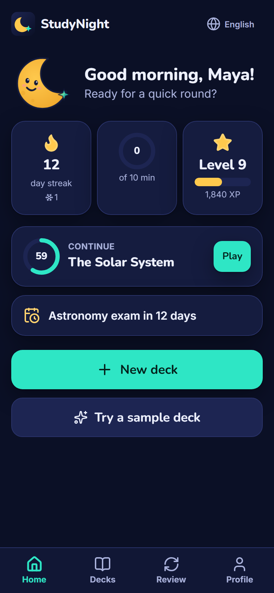 | 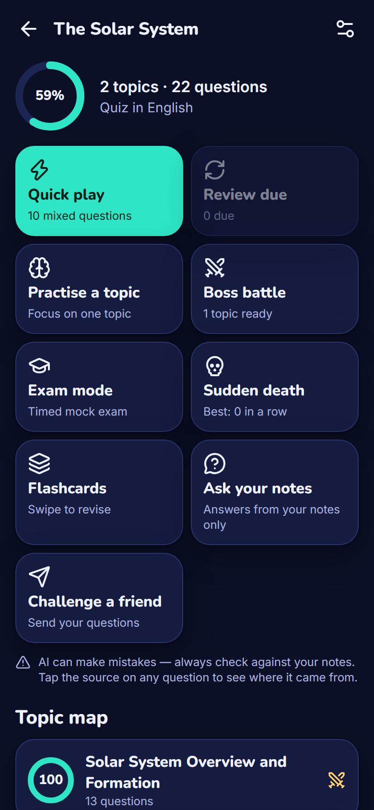 | 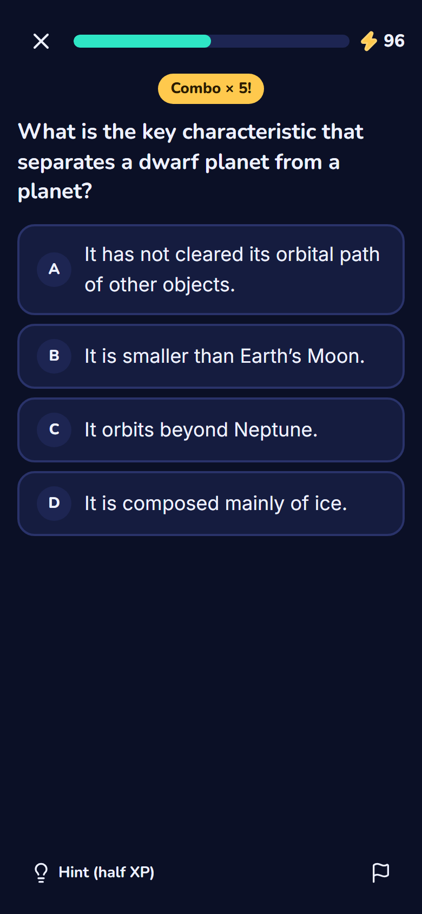 | 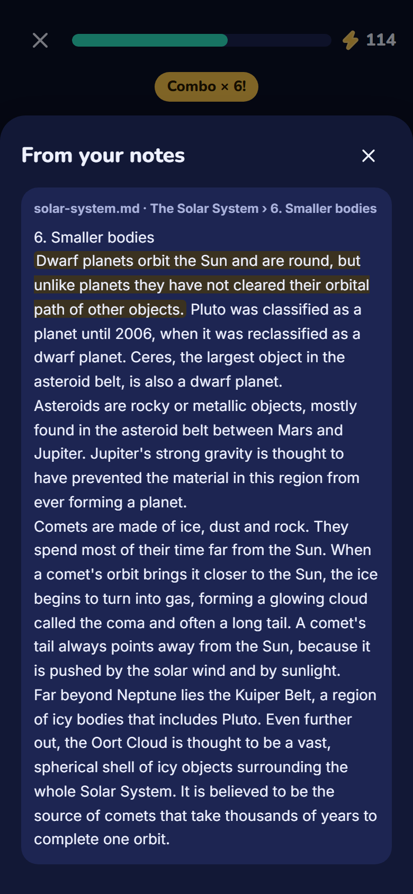 | 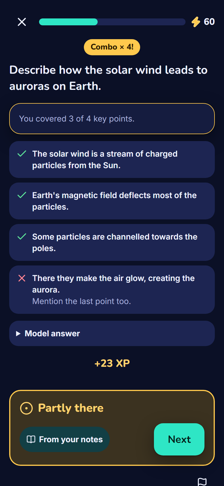 |

| | Upload | Building the quiz | Boss battle | Results | Profile |
|---|---|---|---|---|---|
| **Light** | 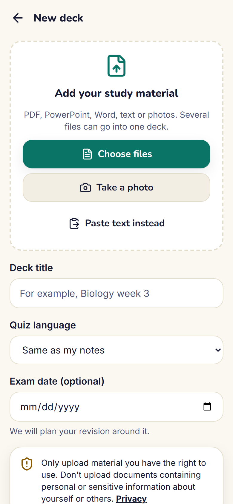 | 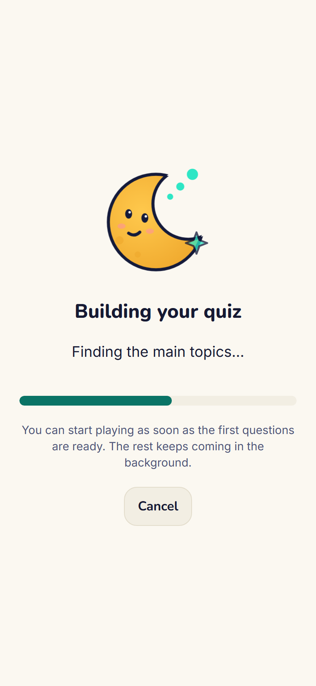 | 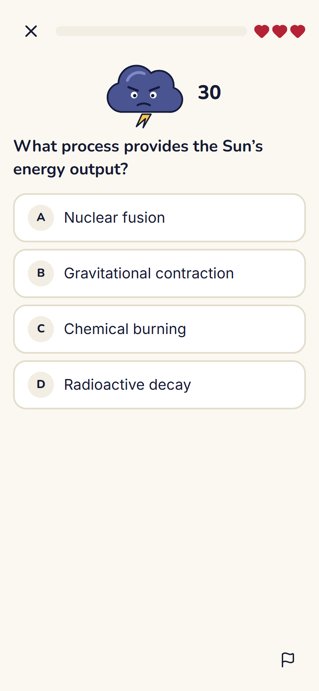 | 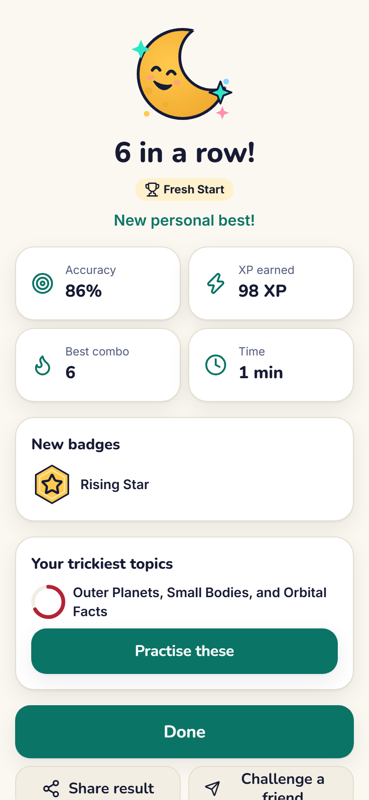 | 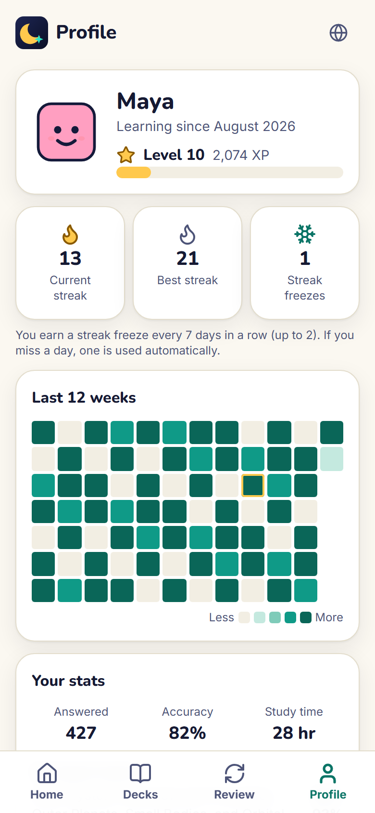 |
| **Dark** | 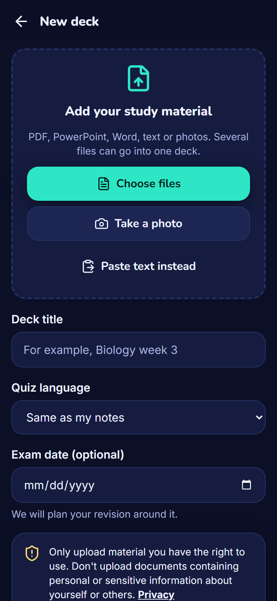 | 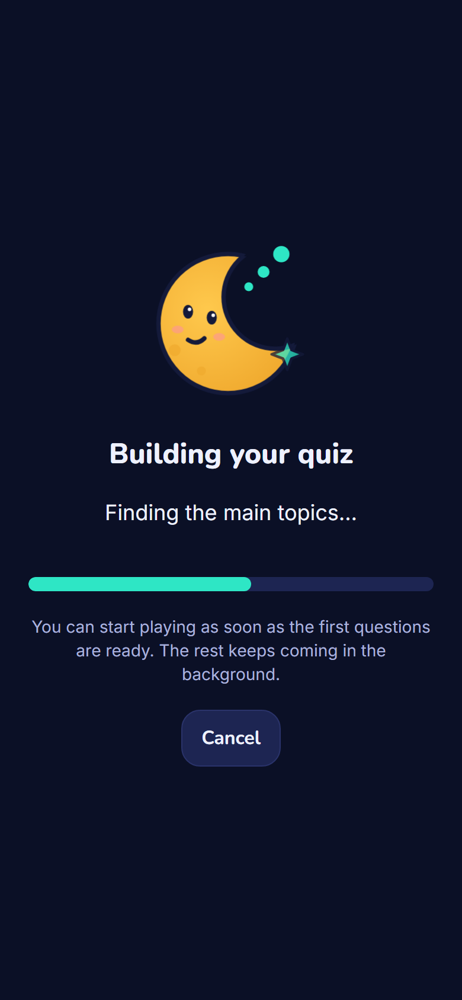 | 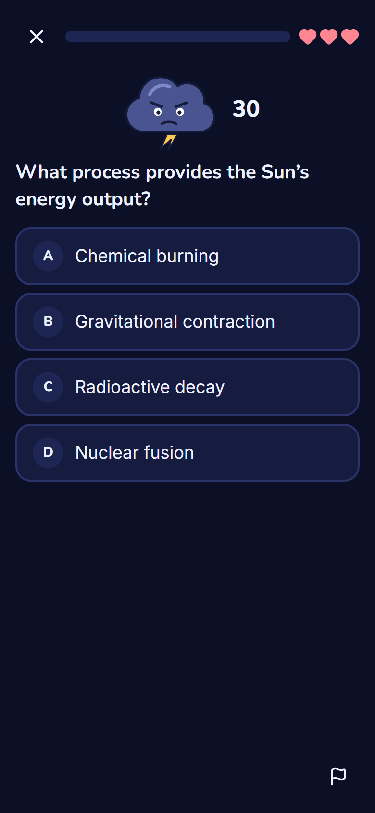 | 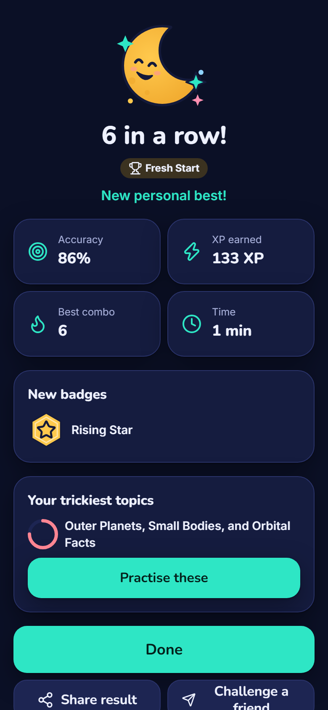 | 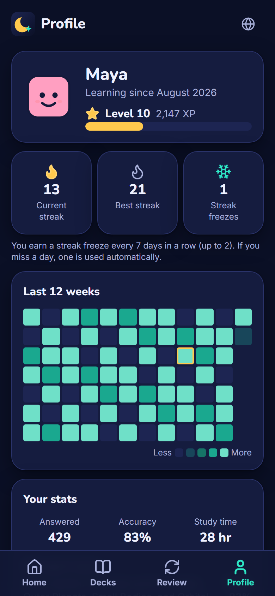 |

| Arabic (right-to-left) | Japanese |
|---|---|
| 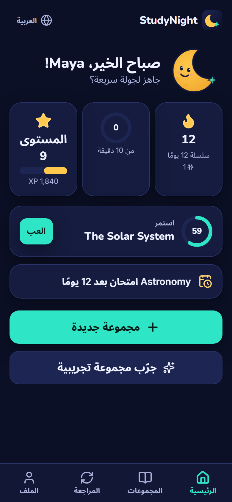 | 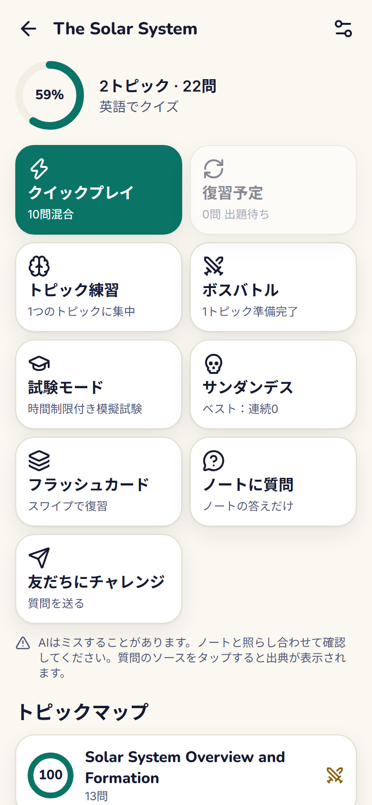 |

## The idea in one line

> **The AI writes questions; code decides everything else.**

The language model only (a) structures your document into topics, (b) drafts questions from retrieved passages,
(c) checks drafts against the source, and (d) judges which key points a free-text answer covers. Scoring, XP, streaks,
spaced-repetition scheduling, difficulty, exam plans and all statistics are deterministic, tested TypeScript running on
your device. **Every question is checked against your own notes before it reaches you** — by code and by a second
model — which catches most mistakes but not all of them (see [Limitations](#limitations)).

## Features

- **Any study material** — PDF, PowerPoint, Word, text, Markdown, photos (camera on phones; handwriting is best effort)
  or pasted text; several files per deck; scanned pages and photos are read by a vision model.
- **Seven question types** — multiple choice, true/false, fill in the blank, flashcards, match pairs, put in order and
  *explain in your own words* (typed or spoken, graded by key points), plus questions about figures, and code and
  LaTeX maths.
- **Every question cites its source** — tap the chip to see the exact passage with the evidence highlighted. Report a
  question in one tap and it is gone for good (with undo).
- **Game modes** — quick play, practise a topic, review due, **boss battle**, timed **exam mode** with an estimated
  score band, **sudden death**, swipeable flashcards and **challenge a friend** with a link (no server involved).
- **Ask your notes** — answers only from your notes, with numbered citations, or plainly says the notes don't cover it.
- **Learns with you** — FSRS spaced repetition, mastery per topic, adaptive difficulty, XP, levels, streaks with
  freezes, 22 badges, playful session titles, an exam planner with calendar export.
- **Smart search** — a multilingual embedding model runs on your device (notes in one language, questions in another);
  keyword search works instantly without it.
- **21 interface languages** — including right-to-left Arabic, Persian and Urdu — and quizzes in almost any language.
- **Private by design, works offline** — no account, analytics or cookies; your decks and progress stay on your device,
  with backup, import and delete. AI features send short excerpts of your notes (never whole files) to Groq — see
  [Privacy](#privacy). Installable, and everything you have made plays offline.

## How it works

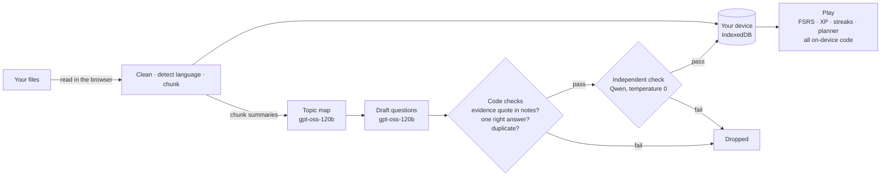

1. **Read** — files are parsed in the browser (pdf.js, JSZip, mammoth); scanned pages and photos are resized and read
   by a vision model. Headers, footers and page numbers are removed, the language is detected and the text is split
   into ~300-word chunks that keep their page and heading.
2. **Organise** — compact chunk summaries (never the whole file) become a topic map.
3. **Generate lazily** — the first topic's questions are ready within seconds; the rest arrive in the background and
   more are written on demand as you play.
4. **Verify** — every draft must quote its evidence verbatim from your notes (checked by code), pass structural checks,
   and then be confirmed by a second model from a different family. Only then is it stored.
5. **Learn** — everything after that is code: [the formulas are documented](docs/ARCHITECTURE.md#learning-engine-all-in-srcliblearning-unit--and-property-tested).

## Benchmark

Measured on an original, multilingual benchmark (10 documents in 5 languages, 60 labelled retrieval questions,
34 labelled free-text answers). Full method, numbers and caveats: **[docs/BENCHMARK.md](docs/BENCHMARK.md)**.

| What | Result |
| --- | --- |
| Generated questions with a correct answer key (reviewed by the AI assistant, see below) | **95%** (97 of 102) |
| Drafts that pass the app's own checks (evidence quote, structure, second model) | 90% |
| Search finds the right passage in the top 5 | 98% same language · 53% across languages |
| Ask your notes: answered with a correct citation / refused when the notes don't cover it | 100% (26/26) · 100% (10/10) |
| Grading of written answers agrees with reference labels | 98% of key points |
| From a 14-page document to the first playable questions | 7.7 s |
| Lighthouse mobile: performance / accessibility / best practices / SEO | 92 / 98 / 96 / 100 |

*Synthetic dataset written for this project. The labels, the review of generated questions and the sample-deck reviews
were done by the AI coding assistant that built the project (Claude Code), with at most a spot check by the author —
not by an independent human reviewer. Small samples — see the caveats in the benchmark document.*

## Privacy

- No accounts, no analytics, no tracking, no ads, no cookies.
- Decks, questions, progress and profile live only in your browser (IndexedDB). Export a backup to move to a new phone;
  delete everything in one tap.
- When you use an AI feature, short text excerpts (never whole files), resized images or short voice clips go through
  stateless serverless functions to [Groq](https://groq.com). Our code stores and logs no content. Groq's data terms,
  checked on 9 November 2026, are summarised on the in-app Privacy page and in [docs/LEGAL.md](docs/LEGAL.md).
- Challenge links and share cards never contain your notes.

*The Privacy Policy and Terms are written in plain language; you may want them reviewed by a qualified person before a
store release.*

## Tech stack

| Area | Choice |
|---|---|
| App | Vite, React 19, TypeScript (strict), Tailwind CSS 4, Framer Motion, Zustand, wouter |
| Data | Dexie (IndexedDB) with versioned migrations, Zod everywhere |
| Documents | pdf.js, mammoth, JSZip, franc-min |
| Search | BM25 + `multilingual-e5-small` via transformers.js (WebAssembly, Web Worker), weighted reciprocal rank fusion |
| Learning | ts-fsrs, custom mastery / difficulty / XP / streak / planner modules |
| AI | Groq: `openai/gpt-oss-120b` (generator), `qwen/qwen3.8-27b` (verifier, grader, vision), Whisper (speech) — chosen 9 November 2026, configurable |
| Server | Vercel Functions (Node, Web `Request`/`Response`), official `groq-sdk` |
| Quality | Vitest, fast-check, Playwright (E2E, 21-language sweep, axe-core audit), ESLint, Prettier, licence and secret checks in CI |
| Platform | PWA (vite-plugin-pwa), ready for Google Play as a Trusted Web Activity ([guide](docs/PLAY_STORE.md)) |

## Run it locally (Windows, macOS or Linux)

*Review only: the code is published so that it can be read and evaluated, for example by running it locally. No
licence is granted to copy, modify or redistribute it — see [Licence](#licence).*

You need Node.js 20 or newer and a free [Groq API key](https://console.groq.com/keys).

```bash
git clone https://github.com/UmitKayaardi/studynight.git
```

```bash
cd studynight
```

```bash
npm ci
```

Copy `.env.example` to `.env` and put your key after `GROQ_API_KEY=`. Then:

```bash
npm run dev
```

Open http://localhost:5173 — the app and the `/api` functions run together. Sample decks work without a key.

Useful commands:

```bash
npm run check
```

```bash
npm run test:e2e
```

```bash
npm run live:check
```

`npm run check` runs lint, types, unit tests, the i18n and hard-coded-string checks, the licence check and the secret
check. `npm run test:e2e` runs Playwright against a production build with every AI call mocked.
`npm run live:check` calls each endpoint once against your running dev server with your key.

## Deploy your own

With the [Vercel CLI](https://vercel.com/docs/cli) (the free Hobby plan is enough):

```bash
vercel link --yes --project studynight
```

```bash
node scripts/vercel-env.mjs
```

```bash
vercel deploy --prod
```

`scripts/vercel-env.mjs` copies the `GROQ_*` variables from `.env` into the project without printing them.
Model names can be changed with the `GROQ_*_MODEL` variables (see `.env.example`) if Groq retires a model.

## Limitations

- **A free, shared AI key has limits.** Groq's free plan limits tokens per minute and per day for each model, shared by
  everyone using a deployment. When it is busy, StudyNight waits and retries calmly and you can keep playing what you
  already have, but creating many decks at once will be slow.
- The `/api` endpoints have only a best-effort flood guard: 120 requests per 10 minutes per IP address and endpoint,
  kept in memory on each server instance (tested on the live site). There is no daily cap per user beyond Groq's own
  free-tier limits.
- AI can make mistakes. Every question is checked against your notes, and you can see its source and report it, but
  checks are not a guarantee.
- Handwriting recognition is best effort, and figure questions are only as good as the image description.
- Smart search downloads about 130 MB once; without it, search is keyword-only (still works, less well across
  languages).
- Data lives in one browser on one device; use backup and import to move it.

## Documentation

[Architecture](docs/ARCHITECTURE.md) · [Benchmark](docs/BENCHMARK.md) · [Legal and privacy design](docs/LEGAL.md) ·
[Google Play guide](docs/PLAY_STORE.md) · [Decisions](DECISIONS.md) · [Third-party notices](THIRD_PARTY_NOTICES.md) ·
[Changelog](CHANGELOG.md)

## Licence

Copyright © 2026 Umit Kayaardi. **All rights reserved.** The source code is published for portfolio review only; no
licence is granted to copy, modify or redistribute it. Third-party components remain under their own licences — see
[THIRD_PARTY_NOTICES.md](THIRD_PARTY_NOTICES.md).
