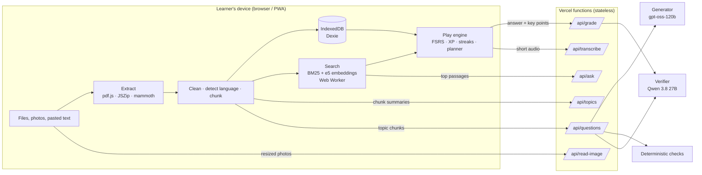

# StudyNight architecture

> **The AI writes questions; code decides everything else.**
> The language model only (a) structures documents into topics, (b) drafts questions from retrieved passages,
> (c) checks drafts against the source, and (d) judges which key points a free-text answer covers. Scoring, XP,
> streaks, spaced-repetition scheduling, difficulty, exam plans and every statistic are deterministic, tested
> TypeScript running on the learner's device. No question reaches the learner unless it passes verification
> against their own notes.

## Overview



Only text chunks, resized images and short audio clips ever leave the device, and only when the learner uses an
AI feature. The server keeps nothing: it validates, calls Groq, validates again and returns.

## Repository layout

| Path | What lives there |
|---|---|
| `src/screens/` | One file per screen (lazy-loaded except Home). |
| `src/components/` | UI primitives, art (mascot, logo, avatars, badges, boss), play components, charts. |
| `src/lib/learning/` | Pure learning engine: FSRS wrapper, mastery, adaptive difficulty, XP, streaks, planner, badges, titles, selection, randomness. |
| `src/lib/ingest/` | Extractors (PDF, PPTX, DOCX, text, photos), cleaning, language detection, chunker. |
| `src/lib/search/` | BM25, vector search, Reciprocal Rank Fusion, embeddings worker and client. |
| `src/lib/deck/` | Deck pipeline, lazy generation queue, Smart search embedding, statistics. |
| `src/lib/game/` | Answer evaluation and recording (one IndexedDB transaction per answer). |
| `src/db/` | Dexie schema and migrations, repositories, backup, storage. |
| `src/store/` | Zustand stores: app (settings, profile, toasts) and play (the session). |
| `src/i18n/` | i18next runtime, 21 locale files, script fonts. |
| `shared/` | Code used by both the app and the functions: API schemas, question model, text utilities. |
| `server/` | Function logic: Groq client, prompts, deterministic checks, verifier, grader, guard. |
| `api/` | Thin Vercel function entry points. |
| `scripts/` | Checks (i18n, strings, secrets, licences, bundle), translation, icons, notices, sample decks. |
| `benchmarks/` | Original benchmark dataset and runner. |

## Ingestion

1. **Extract** per page/slide with a `sourceRef` for every block: PDF via pdf.js (text per page, larger lines become
   headings), PPTX via JSZip (slide titles, body, tables and speaker notes, in presentation order), DOCX via mammoth
   (headings preserved), Markdown/text, pasted text.
2. **Vision** for pages with almost no text (scanned PDFs, capped at 30 pages per deck with a page chooser) and photos
   (resized to ≤ 1,600 px JPEG in the browser, which strips EXIF). `/api/read-image` returns structured Markdown and,
   when there is a figure, a factual description used for figure questions.
3. **Clean**: running headers/footers detected by repetition across pages, page numbers, hyphenation, hard line wraps,
   Unicode NFC.
4. **Detect language** with franc-min plus a script fallback; the topic call can correct an undetermined result.
5. **Chunk**: sentence units (`Intl.Segmenter`), 250–400 words, headings start new chunks, ~15 % overlap inside a
   section, refs kept. Property tests check coverage, order, size and refs.
6. **Index**: BM25 immediately; embeddings later in the background if Smart search is on.

## Retrieval

- BM25 over folded tokens (CJK as character bigrams).
- Embeddings: `Xenova/multilingual-e5-small` (MIT, int8 ONNX) in a Web Worker via transformers.js, with the ONNX
  Runtime WebAssembly files served from our own origin. Vectors are L2-normalised Float32Arrays stored in IndexedDB;
  brute-force cosine search over a contiguous matrix (5,000 × 384 in a few milliseconds, tested).
- Hybrid: weighted Reciprocal Rank Fusion, `score(d) = Σ wᵢ / (60 + rankᵢ(d))` with BM25 weight 0.5 and vector
  weight 1 (chosen with the benchmark). Without the model, search silently uses BM25 only.

## Question generation and verification

Per topic, lazily: the first topic during deck creation, the rest in the background, more on demand. Each request
sends up to four chunks (a window that moves each round), the requested types (multiple choice plus three rotating
types), a target difficulty from the topic's skill estimate and the prompts of existing questions.

Verification of every draft, in order:

1. **Deterministic checks** (`server/verify.ts`): schema; cited chunks exist; the verbatim `evidenceQuote` is found in
   a cited chunk (approximate substring match ≥ 0.9 after folding); multiple choice has four distinct options and no
   "all/none of the above"; true/false statements are not the evidence verbatim and false ones carry a correction;
   fill-ins have exactly one blank and the answer is not in the prompt; match/order items are unique; no e-mail or
   phone patterns; not a duplicate (same prompt or word-bigram similarity ≥ 0.8). Formula answers without `$…$` are
   wrapped.
2. **Independent model check** with a different model family (Qwen) at temperature 0, given only the evidence chunks
   and the question with its stated answer: `supported`, `singleCorrectAnswer`, `answerCorrect`,
   `distractorsClearlyWrong`, `clear` — all must be true.
3. On the device, near-duplicates are also dropped by embedding similarity when Smart search is on.

Prompt-injection safety: sources are wrapped in `<<<SOURCE …>>>` delimiters, every prompt says that text inside them is
data, outside knowledge and personal data are forbidden, and harmful content must not be used. JSON-mode failures are
repaired (invalid escapes, LaTeX commands swallowed by JSON escapes) or retried once.

## Learning engine (all in `src/lib/learning/`, unit- and property-tested)

**FSRS.** Every question has an FSRS card (`ts-fsrs`, desired retention 0.9, no fuzz). Ratings come from code:
wrong → Again; correct after a hint → Hard; explain answers ≥ 80 % of key points → Good, ≥ 40 % → Hard, else Again;
a fast correct answer on an easy question → Easy; otherwise correct → Good; flashcards use the learner's own grade.

**Mastery** of a topic, 0–100 %:

```
mastery = 100 × (0.6 × mean retrievability of the topic's active questions + 0.4 × accuracy of the last 10 answers)
```

A question that was never answered has retrievability 0, so coverage is part of the mean. A topic is *weak* below
50 % once practised; the boss battle unlocks at 60 %.

**Adaptive difficulty.** A skill estimate per topic in [1, 3], starting at 1.5, updated like an Elo rating:
`skill ← clamp(skill + 0.35 × (outcome − 1/(1 + e^(−2(skill − d)))), 1, 3)` for a question of difficulty `d`.
Correct answers never lower it and wrong answers never raise it (property-tested). The target difficulty is the
nearest whole level.

**XP.** Base XP by type (true/false 8, flashcard 6, multiple choice 10, fill-in 14, match 16, order 16, explain 20) ×
difficulty (1, 1.25, 1.5); wrong answers earn nothing; explain answers earn in proportion to key points covered; a
hint halves the XP; combo bonus +2 per answer in a row beyond the second (max +10); reported questions earn nothing
(XP is revoked if a question is reported after answering). Bonuses: round of ≥ 5 answers +10, daily goal +20, boss
victory +50, perfect exam +30. Level `L` starts at `60 × (L − 1)^1.6` XP.

**Daily goal** is measured in active study time: the gap between consecutive interactions counts, capped at 60 s,
so idle time is excluded.

**Streaks** use calendar dates in the device's time zone (`Intl.DateTimeFormat`), never 24-hour spans, so DST and
travel cannot break a day (tested across a year in four zones). A day counts once a question is answered. A streak
freeze is earned every 7 days in a row (max 2) and used automatically for missed days.

**Exam planner.** Practice needed per topic: `max(5, ⌈max(questions, 10) × (1 − mastery) × 1.5⌉)` unless mastery
≥ 90 %. Weakest topics first, spread evenly over the days before the exam (≤ 60 per day), due reviews spread over all
days, the last day kept for a mock exam. Edge cases (exam today, tomorrow, passed, no topics) are tested.

**Predicted exam band** (labelled as an estimate): centre `= 100 × (0.5 × exam accuracy + 0.5 × mean retrievability
of the deck)`, half-width `8 + 25/√n`, clamped to 0–100.

**Randomness** for question order and option shuffling uses `crypto.getRandomValues` with rejection sampling.

## Data

IndexedDB (Dexie) with versioned schema: `decks`, `sources`, `chunks` (text, refs, vector), `images`, `topics`,
`questions`, `cardStates`, `reviews` (answer log without free text), `sessions`, `profile`, `badges`, `exams`,
`settings`, `days` (v2, backfilled from reviews in the migration). Deleting a deck removes everything derived from it
and keeps an in-memory snapshot for the undo toast. Backups are versioned JSON (`.studynight`) without embeddings,
validated with Zod before a previewed, confirmed replace.

## Offline and PWA

vite-plugin-pwa precaches the app shell and every lazily loaded screen; script font slices and the ONNX Runtime are
cached on first use; `/api` is never cached. Anything already generated plays offline; sample decks work fully
offline; sessions started offline skip explain questions. A "new version" toast offers a refresh.

## Security

Strict CSP in `vercel.json` (self, WebAssembly, blob workers, Hugging Face hosts for the model; the browser never
calls Groq), `nosniff`, strict referrer policy, microphone/camera for this origin only, no framing. Every endpoint
checks method, content type, size and schema in and out, maps errors to fixed codes and never logs request content.
A best-effort per-IP guard (120 AI requests per 10 minutes per instance) stops scripted floods. Model output is always
rendered as text; only KaTeX and highlight.js output is injected, enforced by a lint rule.

## Internationalisation

21 UI languages with lazy locale files, RTL for Arabic, Persian and Urdu (`dir` on `<html>`, logical CSS properties,
mirrored directional icons and swipe directions), ICU-style plurals, `Intl` for numbers and dates, Noto script fonts
loaded only when needed. CI guards: every key present with matching variables and plural forms; no hard-coded strings
in components; a Playwright sweep of every main screen and question type in all 21 languages, light and dark, at
360 px (no overflow, no clipped buttons, script-font glyph coverage, correct direction).

## Testing

Vitest (learning engine, ingestion, search, server with a fake Groq client, data layer, migrations, backup,
components), fast-check property tests, Playwright E2E against the production build with every `/api` call mocked
(CI never calls Groq), the language sweep, plus local-only checks: `npm run live:check` and `npm run benchmark`.
